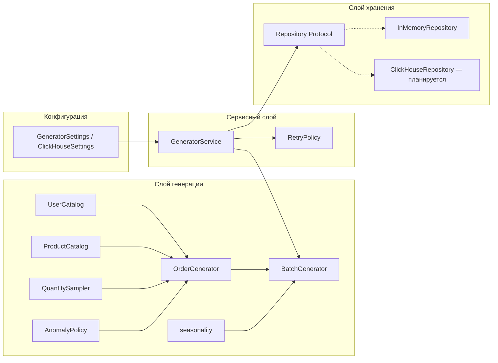

<h1 align="center">🛒 Shop Analytics</h1>

<p align="center">
  Платформа потоковой аналитики интернет-магазина
</p>

<p align="center">
  <em>Генерация, хранение, анализ и визуализация данных о покупках</em>
</p>

<p align="center">
  
  
  
  
  
</p>

---

## 📖 О проекте

**Shop Analytics** — учебная платформа потоковой аналитики интернет-магазина,
предназначенная для генерации, хранения, анализа и визуализации данных
о покупательской активности.

Проект моделирует работу интернет-магазина с учётом популярности товаров,
покупательского поведения, географического распределения пользователей,
суточной и недельной сезонности, а также аномальных заказов.

Цель проекта — построение полного аналитического пайплайна:

**Генерация → Хранение → Анализ → Визуализация**

На текущем этапе реализуется модуль генерации данных.

## ✨ Возможности модуля генерации

- 📦 **Каталог товаров** — 300 товаров в 12 категориях с фиксированными ценами.
- 👥 **Пользователи** — 5712 покупателей из 20 городов России.
- 🎯 **Моделирование спроса** — выбор товаров с учётом их стоимости, категории и популярности.
- 🛍 **Покупательская активность** — различная частота покупок у пользователей.
- 🌍 **Географическое распределение** — неодинаковая доля покупателей в разных городах.
- 🌗 **Сезонность** — изменение интенсивности заказов в зависимости от времени суток и дня недели.
- ⚡ **Аномалии** — оптовые покупки и аномально дорогие заказы с флагом `is_anomaly`.
- 📅 **Backfill** — генерация исторических данных с 1 января 2025 года.
- 🔄 **Realtime** — продолжение генерации в реальном времени после заполнения истории.
- 🚀 **Батчевая запись** — сохранение исторических данных пачками.
- 🔁 **Устойчивость к отказам** — retry с экспоненциальным backoff и джиттером.
- 💾 **Восстановление генерации** — продолжение с последнего сохранённого таймстемпа и идентификатора заказа.
- 🧪 **Воспроизводимость** — использование seed для управления случайной генерацией.

---

## 🏗 Архитектура

Проект построен по принципам чистой архитектуры: доменные модели и логика
генерации не зависят от конкретной реализации хранилища.



### Слои

| Слой | Файл | Ответственность |
|------|------|-----------------|
| Домен | `models.py` | Модели User, Product и Order |
| Генерация | `generation/` | Справочники, спрос, сезонность и аномалии |
| Сервис | `service/generator.py` | Управление backfill и realtime |
| Хранение | `repository/` | Интерфейс Repository и его реализации |
| Конфигурация | `config.py` | Настройки из переменных окружения |
| Устойчивость | `retry.py` | Повторные попытки при отказах хранилища |

### Применяемые принципы

- **Ports & Adapters (DIP)** — сервис зависит от абстракции Repository,
  а не от конкретной базы данных.
- **Инъекция зависимостей** — компоненты передаются сервису извне.
- **Разделение ответственности (SRP)** — каждый компонент отвечает
  за отдельную часть логики.
- **Чистые функции** — коэффициенты сезонности рассчитываются
  на основании переданного момента времени.

---

## 📊 Модель данных

### Users — справочник пользователей

| Поле | Тип | Назначение |
|------|-----|------------|
| `user_id` | int | Идентификатор пользователя |
| `city` | str | Город пользователя |
| `registered_at` | datetime | Дата регистрации |

### Products — справочник товаров

| Поле | Тип | Назначение |
|------|-----|------------|
| `product_id` | int | Идентификатор товара |
| `name` | str | Название товара |
| `category` | str | Категория товара |
| `price` | Decimal | Цена товара |

### Orders — заказы

| Поле | Тип | Назначение |
|------|-----|------------|
| `order_id` | int | Идентификатор заказа |
| `timestamp` | datetime | Время оформления заказа (UTC) |
| `user_id` | int | Идентификатор покупателя |
| `product_id` | int | Идентификатор товара |
| `product` | str | Название товара |
| `category` | str | Категория товара |
| `price` | Decimal | Цена единицы товара |
| `quantity` | int | Количество единиц товара |
| `city` | str | Город покупателя |
| `is_anomaly` | bool | Признак аномального заказа |

Одна запись соответствует заказу одного вида товара в количестве
одной или нескольких единиц.

Для хранения денежных значений используется тип `Decimal`,
позволяющий избежать ошибок вычислений с плавающей точкой.

---

## 📈 Генерация данных

### Историческая генерация (Backfill)

При запуске генератор заполняет исторические данные с 1 января 2025 года
до текущего момента.

Базовый интервал между заказами составляет 600 секунд.
Фактический интервал изменяется с учётом покупательской активности.

Данные сохраняются батчами по 1000 записей.

### Генерация в реальном времени (Realtime)

После заполнения исторических данных генератор продолжает создавать
заказы в реальном времени.

Базовая интенсивность исторической и realtime-генерации одинакова,
что позволяет избежать искусственного скачка количества продаж.

### Сезонность

- Максимальная суточная активность — в 16:00 UTC.
- Минимальная суточная активность — в 04:00 UTC.
- Повышение интенсивности заказов в выходные дни на 15%.
- Интервал между заказами зависит от общего коэффициента активности.

### Аномалии

В процессе генерации моделируются два вида аномалий:

- `BULK_ORDER` — покупка необычно большого количества товара.
- `HIGH_VALUE_ORDER` — покупка дорогого товара в повышенном количестве.

Вероятность возникновения аномалии по умолчанию составляет 2%.

---

## ⚙️ Конфигурация

Настройки читаются из переменных окружения и файла `.env`.

Пример конфигурации находится в файле [`.env.example`](.env.example).

### Генератор (`GENERATOR_*`)

| Переменная | По умолчанию | Назначение |
|-----------|--------------|------------|
| `GENERATOR_BATCH_SIZE` | `1000` | Размер батча вставки |
| `GENERATOR_BACKFILL_START` | `2025-01-01T00:00:00` | Начало исторической генерации |
| `GENERATOR_BACKFILL_STEP_SECONDS` | `600.0` | Базовый шаг исторической генерации |
| `GENERATOR_REALTIME_STEP_SECONDS` | `600.0` | Базовый шаг realtime |
| `GENERATOR_SEED` | `42` | Воспроизводимость генерации |
| `GENERATOR_ANOMALY_PROBABILITY` | `0.02` | Вероятность аномалии |
| `GENERATOR_ANOMALY_STRENGTH` | `3.0` | Множитель силы аномалии |
| `GENERATOR_USER_COUNT` | `5712` | Количество пользователей |
| `GENERATOR_CITIES` | 20 городов | Города покупателей |
| `GENERATOR_LOG_LEVEL` | `INFO` | Уровень логирования |
| `GENERATOR_RETRY_MAX_ATTEMPTS` | `5` | Количество попыток записи |
| `GENERATOR_RETRY_BASE_DELAY_SECONDS` | `0.5` | Начальная задержка |
| `GENERATOR_RETRY_MAX_DELAY_SECONDS` | `30.0` | Максимальная задержка |
| `GENERATOR_RETRY_BACKOFF_FACTOR` | `2.0` | Множитель задержки |

### ClickHouse (`CLICKHOUSE_*`)

| Переменная | По умолчанию | Назначение |
|-----------|--------------|------------|
| `CLICKHOUSE_HOST` | `localhost` | Хост базы данных |
| `CLICKHOUSE_PORT` | `8123` | HTTP-порт |
| `CLICKHOUSE_DATABASE` | `shop` | Имя базы данных |
| `CLICKHOUSE_USER` | `default` | Пользователь |
| `CLICKHOUSE_PASSWORD` | — | Пароль |

---

## 🧱 Структура проекта

Основные компоненты генератора:

```text
shop-analytics/
├── src/
│   └── generator/
│       ├── config.py
│       ├── models.py
│       ├── retry.py
│       ├── generation/
│       │   ├── __init__.py
│       │   ├── anomalies.py
│       │   ├── catalog.py
│       │   ├── metrics.py
│       │   ├── orders.py
│       │   └── seasonality.py
│       ├── repository/
│       │   ├── __init__.py
│       │   ├── base.py
│       │   └── in_memory.py
│       └── service/
│           ├── __init__.py
│           └── generator.py
├── .env.example
├── .gitignore
├── pyproject.toml
└── README.md
```

---

## 🧪 Проверка генератора

В ходе разработки проведена проверка генерации 100 000 заказов.

| Показатель | Результат |
|------------|----------:|
| Количество заказов | 100 000 |
| Уникальные товары | 300 |
| Уникальные покупатели | 5710 |
| Категории товаров | 12 |
| Города | 20 |
| Аномальные заказы | 1985 |
| Доля аномалий | 1,985% |

Дополнительно проверены:

- Корректность работы InMemoryRepository.
- Генерация исторических данных.
- Изменение интервалов между заказами с учётом сезонности.
- Возобновление генерации на существующем хранилище.
- Последовательность идентификаторов заказов.
- Корректность дат регистрации покупателей.
- Отсутствие заказов с будущими таймстемпами.

---

## 📉 Планируемые направления аналитики

- Динамика выручки и количества заказов.
- Средний чек.
- Популярность товаров и категорий.
- Географическое распределение продаж.
- Суточная и недельная активность покупателей.
- Активность уникальных покупателей (DAU, WAU, MAU).
- Анализ повторных покупок.
- Выявление аномальных заказов.

---

## 🛠 Технологический стек

| Технология | Назначение |
|------------|------------|
| Python 3.12 | Генерация и обработка данных |
| Pydantic Settings | Управление конфигурацией |
| ClickHouse | Хранение и аналитические запросы |
| SQL | Агрегация и анализ данных |
| Apache Superset | Визуализация и дашборды |
| Jupyter Notebook | Исследовательский анализ |
| Docker Compose | Развёртывание компонентов |
| pytest | Автоматизированное тестирование |
| Git / GitHub | Контроль версий |

---

## 🚧 Этапы разработки

- [x] Доменные модели.
- [x] Каталог товаров и пользователей.
- [x] Моделирование покупательского поведения.
- [x] Генерация аномалий.
- [x] Суточная и недельная сезонность.
- [x] Конфигурация генератора.
- [x] Интерфейс Repository.
- [x] InMemoryRepository.
- [x] Сервис исторической генерации и realtime.
- [ ] CLI и обработка сигналов завершения.
- [ ] Автоматизированные тесты pytest.
- [ ] Интеграционное тестирование realtime.
- [ ] ClickHouseRepository.
- [ ] SQL-запросы и материализованные представления.
- [ ] Docker Compose.
- [ ] Дашборды Apache Superset.
- [ ] Анализ данных в Jupyter Notebook.

---

<p align="center">
  <sub>Shop Analytics · Учебный проект по потоковой аналитике данных</sub>
</p>
