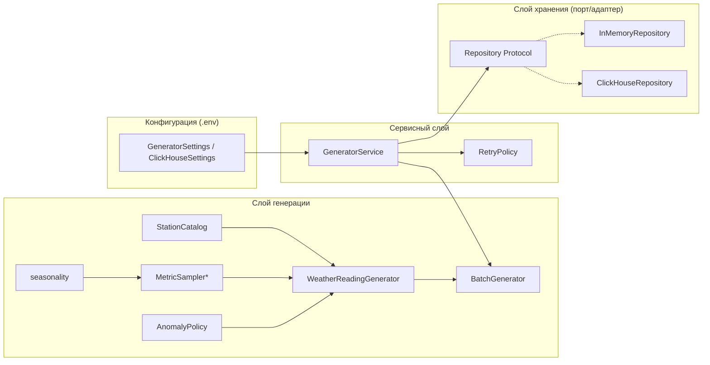

<p align="center">
  <h1 align="center">🌦 Weather Data Generator</h1>
  <p align="center">Генератор реалистичного потока данных метеостанций</p>
  <p align="center">
    <em>Первый модуль учебного End-to-End проекта «система сбора и анализа потоковых данных»</em>
  </p>
  <p align="center">
    
    
    
    
    
  </p>
</p>

---

## 📖 О проекте

Модуль генерирует **реалистичный поток показаний метеостанций** и пишет их **батчами**
в хранилище. Это фундамент E2E-проекта: дальше данные уходят в ClickHouse, а потом
анализируются в Jupyter и визуализируются в Superset.

### ✨ Что умеет генератор

- 🎯 **Реалистичные показания** — температура, влажность, давление, скорость и
  направление ветра, категория погоды.
- 🌗 **Сезонность** — суточный (днём теплее) и годовой (летом теплее) циклы,
  климат конкретного города и случайный шум.
- ⚡ **Аномалии** — редкие выбросы (тепловая волна, скачок холода, падение давления,
  порыв ветра) помечаются флагом `is_anomaly` — «дрожжи» для последующего анализа.
- 🚀 **Батчевая запись** — пачками, а не по одной строке.
- 🔁 **Устойчивость к отказам** — retry с экспоненциальным backoff и джиттером.
- 🛑 **Graceful shutdown** — корректно завершается по `SIGINT`/`SIGTERM`.
- 🧪 **Детерминизм** — при одинаковом `seed` выдаёт одинаковые данные.

---

## 🏗 Архитектура

Проект построен по принципам **чистой архитектуры**: ядро домена не зависит ни от
конкретной БД, ни от способа генерации.



### Слои

| Слой | Файл | Ответственность |
|------|------|-----------------|
| 🧩 Домен | `models.py` | `Station`, `WeatherReading` — чистые модели без знания о БД |
| ⚙️ Генерация | `generation/` | сезонность, самплеры метрик (Strategy), аномалии, справочник |
| 🔄 Сервис | `service/generator.py` | цикл «батч → запись», retry, graceful shutdown |
| 💾 Хранение | `repository/` | порт `Repository` + реализации `InMemory` / `ClickHouse` |
| ⚙️ Конфигурация | `config.py` | настройки из env (префиксы `GENERATOR_*`, `CLICKHOUSE_*`) |

### Применяемые принципы

- **Strategy** — каждая метрика (`TemperatureSampler`, `HumiditySampler`, …) — отдельная
  стратегия с единым контрактом `sample(ctx, rng)`. Новая метрика = один новый класс.
- **Ports & Adapters (DIP)** — сервис зависит от абстракции `Repository`, а не от БД;
  `InMemoryRepository` позволяет запускать генератор без ClickHouse.
- **Инъекция зависимостей** — всё собирается в `cli.py` (композиционный корень).
- **Чистые функции** — сезонность зависит только от момента времени, что легко
  тестировать на фиксированных датах.

---

## 🚀 Быстрый старт

Требуется [uv](https://docs.astral.sh/uv/).

```bash
# 1. Установить зависимости
uv sync

# 2. Быстрая проверка: один батч в память (без БД)
uv run weather-generator --once

# 3. Непрерывная генерация в память (Ctrl+C — graceful shutdown)
uv run weather-generator

# 4. Запись в ClickHouse
cp .env.example .env   # при необходимости отредактировать
uv run weather-generator --repository clickhouse

# 5. Тесты, линт, типы
uv run pytest
uv run ruff check .
uv run mypy src
```

---

## ⚙️ Конфигурация

Настройки читаются из переменных окружения и файла `.env` (см. [`.env.example`](.env.example)).

### Генератор (`GENERATOR_*`)

| Переменная | По умолчанию | Назначение |
|-----------|--------------|------------|
| `GENERATOR_BATCH_SIZE` | `100` | записей в одном батче |
| `GENERATOR_INTERVAL_SECONDS` | `1.0` | пауза между батчами |
| `GENERATOR_SEED` | `42` | воспроизводимость генерации |
| `GENERATOR_ANOMALY_PROBABILITY` | `0.02` | вероятность аномалии на запись |
| `GENERATOR_ANOMALY_STRENGTH` | `3.0` | сила аномалии |
| `GENERATOR_CITIES` | список | города станций через запятую |
| `GENERATOR_RETRY_*` | — | параметры backoff при отказах БД |

### ClickHouse (`CLICKHOUSE_*`)

| Переменная | По умолчанию | Назначение |
|-----------|--------------|------------|
| `CLICKHOUSE_HOST` | `localhost` | хост БД |
| `CLICKHOUSE_PORT` | `8123` | HTTP-порт |
| `CLICKHOUSE_DATABASE` | `weather` | имя БД |
| `CLICKHOUSE_USER` | `default` | пользователь |
| `CLICKHOUSE_PASSWORD` | — | пароль |

---

## 📊 Данные

**`stations`** (справочник/размерность): `station_id`, `name`, `city`,
`latitude`, `longitude`, `altitude`.

**`readings`** (события):

| Поле | Тип | Роль |
|------|-----|------|
| `station_id` | int | связь со справочником |
| `timestamp` | datetime | момент измерения (UTC) |
| `temperature_c` | float | метрика |
| `humidity_pct` | float | метрика |
| `pressure_hpa` | float | метрика |
| `wind_speed_ms` | float | метрика |
| `wind_direction_deg` | float | размерность |
| `weather_type` | enum | размерность: `clear/cloudy/fog/rain/snow/storm` |
| `is_anomaly` | bool | флаг выброса для анализа |

---

## 🧱 Структура проекта

```
src/generator/
├── cli.py                 # CLI, обработка сигналов, композиционный корень
├── config.py              # настройки из env
├── models.py              # доменные модели: Station, WeatherReading
├── retry.py               # RetryPolicy: экспоненциальный backoff + джиттер
├── generation/            # слой генерации данных
│   ├── seasonality.py     # суточный и годовой циклы (чистые функции)
│   ├── metrics.py         # самплеры метрик (Strategy) + ClimateProfile
│   ├── anomalies.py       # AnomalyPolicy: редкие выбросы
│   ├── catalog.py         # справочник станций и климатические профили городов
│   └── weather.py         # WeatherReadingGenerator + BatchGenerator
├── repository/            # слой хранения
│   ├── base.py            # порт Repository (Protocol)
│   ├── in_memory.py       # in-memory реализация (тесты / запуск без БД)
│   └── clickhouse.py      # ClickHouse-реализация (batch insert)
└── service/
    └── generator.py       # GeneratorService: основной цикл
```

---

## 📚 Образовательный контекст

Репозиторий — модуль **генератора** учебного End-to-End проекта. Остальные компоненты
(ClickHouse, Superset, Jupyter, Docker Compose) разбираются в следующих воркшопах и
появляются в других ветках/репозиториях.

---

<p align="center">
  <sub>Сделано для серии воркшопов · Замечания и предложения приветствуются</sub>
</p>